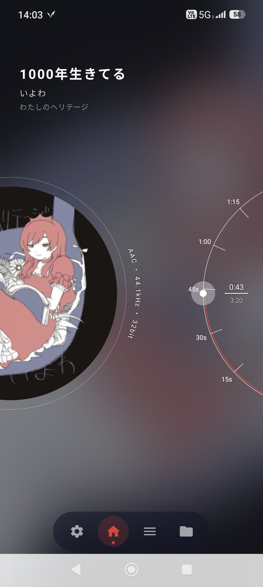
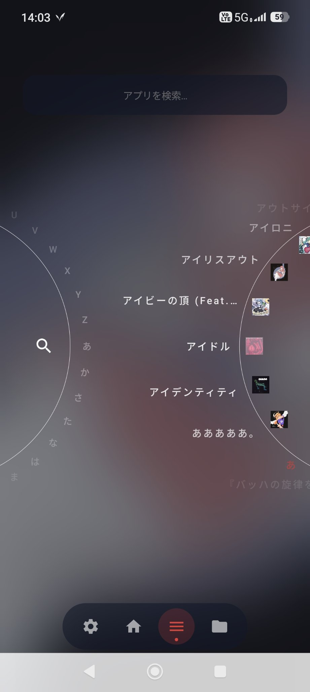
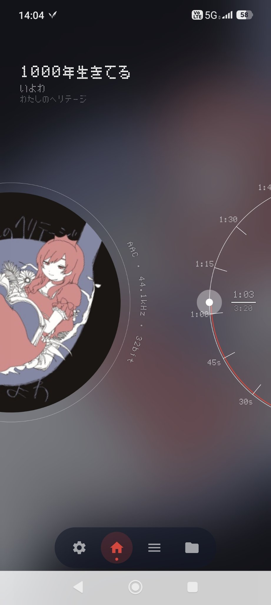

# 🎵 日進月歩ミュージック (Nissin Geppo Music)

  
  
  

Android用のローカル音楽プレーヤーアプリです。
姉妹アプリ「[日進月歩ランチャー](https://github.com/sh4tter815/NissinGeppoLauncher)」のトレードマークである**円盤（ディスク）UI**を音楽再生に転用し、アルバムジャケットがレコード盤になって回転する再生画面や、円形のシークダイアルなど、独特な操作感のプレーヤーを目指して開発中です。

## 📥 インストール方法

ビルド済みのAPKは **[Releasesページ](https://github.com/sh4tter815/NissinGeppoMusic/releases)** からダウンロードできます（最新の `app-debug.apk`）。

> ⚠️ **注意:** これはデバッグビルドであり、公式ストアの署名とは異なります。インストール時に「提供元不明のアプリ」に関する警告が表示される場合がありますが、「このままインストール」を選択して進めてください。

## ✨ 主な機能

### 💿 レコード盤が回る再生画面
* アルバムジャケットがレコード盤になり、再生中は実際に回転します。
* 盤面の縁には、再生中ファイルのフォーマット情報（AAC / FLAC など）を表示します。
* 背景にはブラーのかかったグラデーションが広がり、ジャケットの世界観に浸れます。

### 🎛 円形シークダイアル
* 右側の大きな円形ダイアルで再生位置を操作できます。
* 15秒・30秒・1分…といった時間の目盛りと、現在の再生時間／総時間を表示します。

### 🎧 ライブラリ＆円盤インデックス
* 端末内の音楽ファイルを自動で読み込み、アルバムアート付きで一覧表示します（MediaStore対応）。
* 画面端の円盤インデックス（A〜Z／あ〜ん）をなぞると、曲名の頭文字へジャンプできます。
* 曲をフォルダに分けて整理することもできます（ランチャー版のフォルダ機能を継承）。

### 🔊 対応形式・再生
* 対応形式: FLAC / MP3 / WAV / AAC（M4A）/ OGG
* 再生エンジンは Media3（ExoPlayer）。MediaSessionにも対応し、バックグラウンド再生が可能です。

### 🔤 フォントカスタマイズ
* デフォルトフォントのほか、レシート風フォントへの切り替えが可能です。
* 好きなフォントファイル（.ttf / .otf）をインポートして使うこともできます。

## 📌 使い方

1. 初回起動時に、端末内のメディアへのアクセス許可を与えてください。
2. 下部のダイアルから画面を切り替えます（設定／ホーム＝再生画面／ライブラリ／フォルダ）。
3. ライブラリで曲を選ぶと再生が始まり、再生画面のレコードが回り出します。

## 🛠 技術スタック

* **言語:** Kotlin
* **UI:** Jetpack Compose
* **再生:** Media3 ExoPlayer / MediaSession
* **ライブラリ取得:** MediaStore API
* **ベース:** [日進月歩ランチャー](https://github.com/sh4tter815/NissinGeppoLauncher) のコードベースを複製して開発

## 🤖 開発について

プログラミング未経験の作者が、生成AI（Gemini）を相棒に試行錯誤しながら開発しています。
「日進月歩ランチャー」の回転する円盤UIを眺めていて「これ、レコード盤にしたら音楽プレーヤーになるのでは？」と思ったのが、このアプリの始まりです。日々少しずつ、一歩ずつアップデートしていきます。

## 📄 ライセンス (License)

このプロジェクトは [MIT License](LICENSE) のもとで公開されています。
